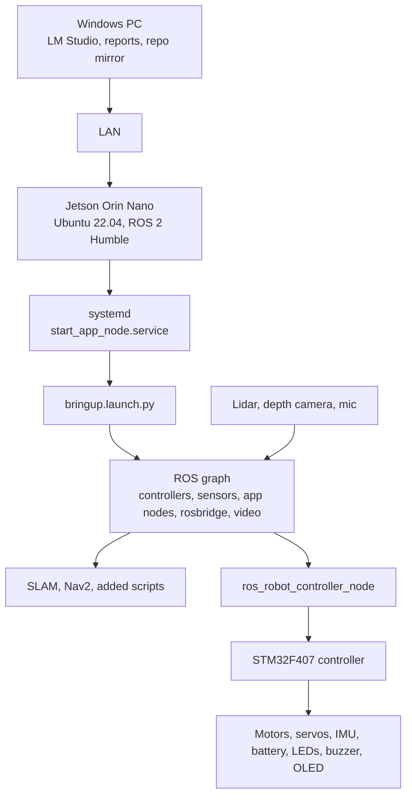

# Architecture

This document explains the robot as a layered system. It focuses on flows and design choices; package-by-package details belong in `docs/CODE_WALKTHROUGH.md`.

## Layers



The core split is Jetson versus STM32. The Jetson owns Linux, ROS, perception, navigation, web services, and model clients. The STM32 owns hard real-time-ish low-level hardware control and reports hardware state back to ROS through the serial bridge.

Source references:

- `docs/SYSTEM.md` for OS, boot, live graph, network, and device names;
- `docs/HARDWARE.md` for physical components and measured field facts;
- `docs/VENDOR_STACK.md` for package responsibilities;
- `docs/MODIFICATIONS.md` for user changes and their reasons.

## Boot Flow

```mermaid
flowchart TD
  boot[Robot boots Ubuntu] --> unit[start_app_node.service]
  unit --> zsh[/bin/zsh loads shell rc chain]
  zsh --> env[ros2_ws env, .robotrc, .typerc]
  env --> launch[ros2 launch bringup bringup.launch.py]
  launch --> controller[controller, odom, EKF]
  launch --> peripherals[lidar, camera, IMU, joystick]
  launch --> apps[vendor app/demo nodes]
  launch --> web[rosbridge :9090\nweb_video_server :8080]
```

The service uses the shell environment rather than a minimal static environment. That matters because product identity and device behavior are selected by variables such as `MACHINE_TYPE`, `LIDAR_TYPE`, `DEPTH_CAMERA_TYPE`, `MIC_TYPE`, and `ROS_DOMAIN_ID`.

Operational consequence: use the shell setup described in `docs/SYSTEM.md` and `added/guides/OPERATING.md` when running commands manually. A shell with the wrong ROS environment can look like a discovery or device failure.

## Command Flow

```mermaid
flowchart LR
  intent[Operator, joystick, app, Nav2, LLM script] --> vel[Velocity command topics]
  vel --> ctrl[driver/controller\nmecanum mixing, odom path]
  ctrl --> motorTopic[/ros_robot_controller/set_motor]
  motorTopic --> bridge[ros_robot_controller_node]
  bridge --> rrc[/dev/rrc\n1 Mbaud serial]
  rrc --> stm32[STM32]
  stm32 --> motors[Four drive motors]
```

The naming is easy to misread:

- `/cmd_vel` is the safer clamped manual topic documented in `added/guides/OPERATING.md`;
- `/controller/cmd_vel` is the raw path used deeper by controllers/Nav2;
- `/app/cmd_vel` is the app/Ackermann-style path.

Design consequence: documentation and scripts must name the exact topic they use. "Publish cmd_vel" is not precise enough in this stack.

## Sensor Flow

```mermaid
flowchart LR
  lidar[COIN-D6 lidar\n/dev/lidar] --> scan[/scan_raw and /scan]
  camera[Aurora depth camera] --> image[RGB, depth, IR, pointcloud topics]
  mic[WonderEcho Pro\nALSA + /dev/ring_mic] --> voice[ASR/wake/voice nodes]
  stm32[STM32\n/dev/rrc] --> imu[IMU, battery, buttons, servo state]
  scan --> nav[SLAM, localization, costmaps]
  image --> vision[VLM, depth_guard, demos]
  imu --> ekf[EKF odometry]
  voice --> commands[voice/LLM command scripts]
```

The lidar and depth camera are not interchangeable obstacle systems. The lidar has a rear blind spot on this unit. The depth camera is mounted on the arm and looks where the arm points. CPU load also matters: `docs/ADDED_SOFTWARE.md` records that `depth_guard.py` replaced normal pointcloud use for local-costmap obstacle hints because full pointcloud processing starved the CPU.

## Navigation Flow

```mermaid
flowchart TD
  map[Saved map YAML/PGM] --> localization[Localization / initial pose]
  scan[/scan] --> localization
  localization --> tf[map -> odom -> base transforms]
  tf --> nav2[Nav2 planner/controller]
  scan --> costmap[Global/local costmaps]
  depth[depth_guard synthetic scan] --> costmap
  nav2 --> bt[Behavior tree]
  bt --> cmd[/controller/cmd_vel]
```

The most important architecture choice is no-backup navigation. `docs/HARDWARE.md` records the lidar field reality: this physical robot is rear-blind. `docs/MODIFICATIONS.md` records that no-backup behavior trees were added and wired into Nav2. The behavior-tree change is a hardware safety decision, not only a planner preference.

The modified navigation stack layers three related safety/load choices:

| Change | Architectural reason |
|---|---|
| No-backup behavior trees | Rear sensing is not trustworthy enough for reverse recovery |
| TEB reverse capped and heavily penalized | Planner may still need tiny reverse motions, but should prefer forward/turning behavior |
| `/depth_scan` local-costmap source | Forward arm-camera depth can catch thin obstacles without the CPU cost of full pointcloud processing |

The modified SLAM config makes the opposite tradeoff: less frequent scan/map/TF work in exchange for Jetson CPU headroom. It throttles scans, slows map updates, and requires some travel before updates, so mapping becomes less twitchy and less CPU-heavy but also less instantaneous.

## Added Software Layer

The `added/` directory is a task layer over the vendor stack. It includes:

- robot scripts for localization, goals, maps, exploration, tours, vision, voice, and LLM driving;
- robot-home files fetched from `/home/ubuntu`;
- maps and waypoints;
- PC-side report tools;
- operator/handoff guides.

This layer should be documented as workflows and script cards rather than as a new ROS package tree. The provenance boundary matters: if a behavior is in `added/`, it is not factory behavior.

## Design Choices And Consequences

| Choice | Reason | Consequence |
|---|---|---|
| Separate `vendor/`, `vendor-modified/`, and `added/` | Preserve ownership/provenance | Docs must say whether behavior is factory, modified factory, or added |
| Use systemd autostart for factory bringup | Factory robot starts ready for app/ROS use | Manual launches must avoid duplicate stacks and serial contention |
| Use zsh shell rc chain for ROS identity | Factory environment selects robot variant/devices | Remote commands should preserve the ROS environment |
| Physical-port udev rules for lidar/mic | Identical CH340 adapters lack stable serial numbers | Replugging devices can break `/dev/lidar` or `/dev/ring_mic` |
| Disable Nav2 backup behavior | Rear sensing is unsafe on this unit | Recovery options are reduced; navigation may fail rather than reverse |
| Use `depth_guard.py` instead of full pointcloud costmap | Jetson CPU headroom | Less rich obstacle data, but lower load |
| Use LM Studio on PC | Avoid cloud keys and move model load off Jetson | Robot depends on PC IP/model availability for those workflows |
| Keep symlink-installed workspace | Fast iteration on Python/config | Changes still require correct restart discipline |

## Open Documentation Work

The remaining architecture detail should be filled from the package/script cards in `docs/TASKS.md`. The next most valuable additions are:

- exact node/topic/service maps for `driver/ros_robot_controller` and `driver/controller`;
- exact launch/config path map for `navigation` and `slam`;
- a hardware-to-topic matrix with source paths for every row.
