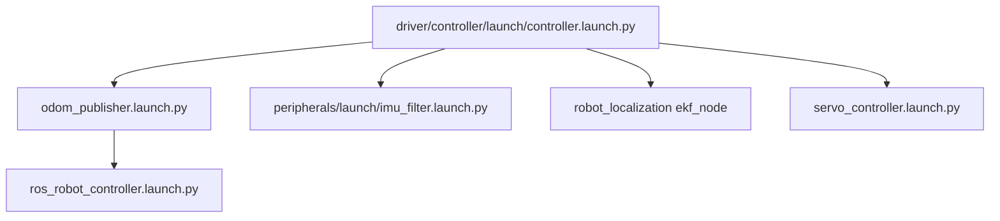
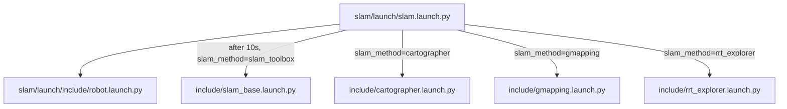
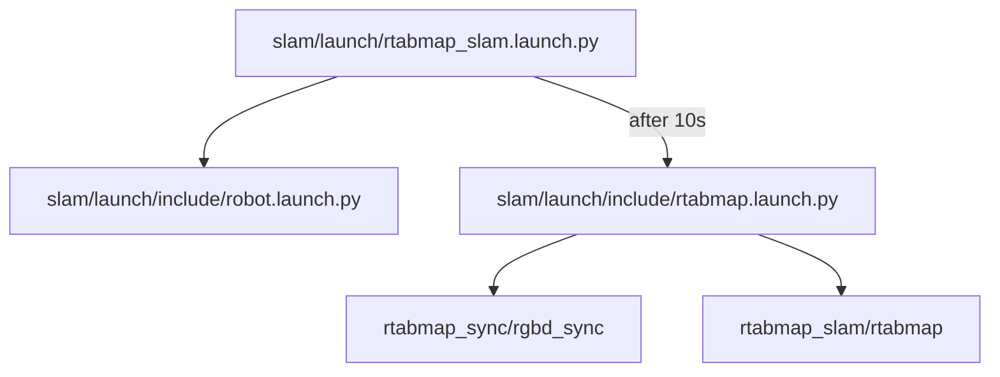
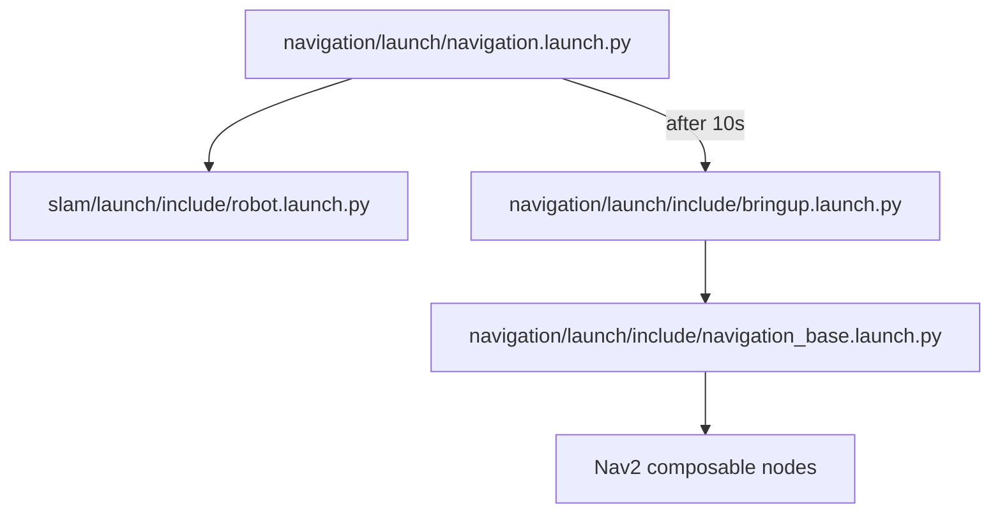
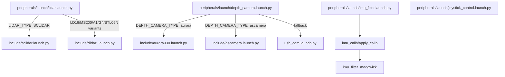
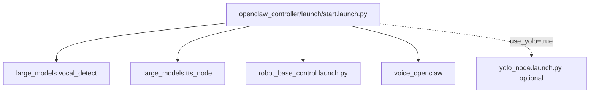
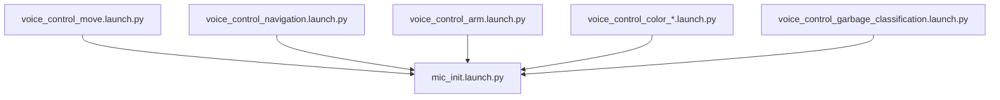

# Launch Flow Map

This map summarizes the launch paths that matter most for understanding or changing the robot. It is source-derived and can be reviewed without a live ROS graph.

## Path Resolution Rule

Many launch files read `need_compile`:

- `need_compile=True`: resolve package paths through `get_package_share_directory(...)`;
- otherwise: use hardcoded source paths under `/home/ubuntu/ros2_ws/src/...`.

Most operator scripts source `~/.zshrc` first, because that shell startup chain supplies the robot environment.

## Base Robot Bringup

Key outputs:

- raw and filtered odometry: `odom_raw`, `odom`;
- raw drive command input: `controller/cmd_vel`;
- clamped drive command input: `cmd_vel`;
- final motor command: `ros_robot_controller/set_motor`;
- servo/arm interfaces through `servo_controller` and `controller_manager/...`.

## SLAM Bringup

`robot.launch.py` starts the controller stack, depth camera, lidar, joystick control, init pose, and optional laser odometry wiring. Mapping nodes are delayed so the base sensor stack has time to start.

## RTAB-Map SLAM

The top-level RTAB launch computes namespaced camera/odom/scan variables but currently only passes `use_sim_time` into the RTAB include. The include itself uses fixed remaps such as `scan -> /scan`.

## Nav2 Bringup

Modified Nav2 config points both single-pose and through-poses navigation at no-backup behavior trees. Local costmap consumes `/scan` and the added `/depth_scan` source when `depth_guard.py` is running.

## Peripherals

On Pro machines, `lidar.launch.py` adds a `laser_filters` chain from `scan_raw` to `scan`.

## OpenClaw

`robot_base_control.launch.py` starts controller, depth camera, lidar, joystick control, `track_and_grab`, kinematics, and init pose.

## Vendor Offline Voice

All voice demo launches include mic initialization plus a task-specific node. Movement and navigation voice demos can publish raw `/controller/cmd_vel`.

## Added Operator Scripts

| Script | Launch/process behavior |
|---|---|
| `phase_a.sh` | Kills heavy demo nodes, locks arm forward, starts/restarts Nav2 on `map_04.yaml`, starts `depth_guard.py`, localizes, saves evidence |
| `boot_tour.sh` | Starts Nav2 and `depth_guard.py` if needed, gates on localization >=90%, then runs tour legs |
| `tour.sh` | Uses existing stack, relocalizes, chooses live costmap goals, runs drums -> door -> window -> start |
| `prep_down.sh` | Switches Nav2 to `map_rtab.yaml`, localizes, saves downstairs evidence without driving |
| `tour_down1.sh` | Runs downstairs plant/kitchen fixed-pose legs with costmap clears and retries |

